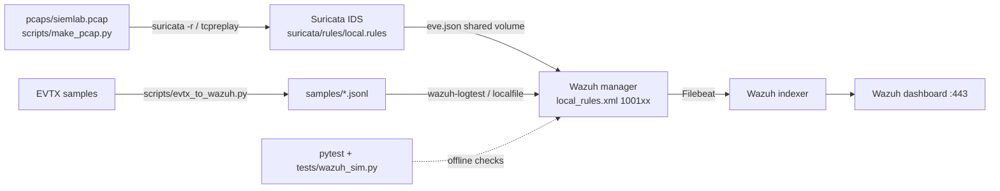

# siem-lab — Wazuh SIEM + Suricata IDS detection lab

**What it does:** runs Wazuh (manager + indexer + dashboard) and Suricata in Docker, feeds Suricata `eve.json` and converted Windows Security/Sysmon/PowerShell EVTX into Wazuh, and raises custom alerts mapped to MITRE ATT&CK.
Detections cover password spray, logon after repeated failures, special-privilege logons, log clearing, malicious PowerShell, LSASS access, WMI-spawned shells, and nmap-style scans.
Rule logic is unit-tested offline (pytest) against public EVTX attack samples and synthetic events. Live Wazuh/Suricata results are marked [RUN-THEN-FILL].


> **[RUN-THEN-FILL: Ansar captures after his own run]** — screenshot of the Wazuh dashboard showing a simulated attack → alert raised → ATT&CK ID (e.g. rule 100150 / T1003.001). Not yet captured: Docker was not available on the build machine, so there is no image yet. Do not use a mock-up.

## Architecture


## Run it
```bash
# 0. offline checks (no Docker needed)
python3 -m venv .venv && .venv/bin/pip install -r requirements-dev.txt
.venv/bin/python -m pytest -v tests            # -> results/pytest.txt
.venv/bin/python scripts/sim_report.py         # -> results/sim_report.txt
# 1. Wazuh certs + indexer/dashboard configs: copy config/ from the official
#    wazuh-docker repo (single-node, same tag as the images, 4.9.2 here) then:
docker compose -f generate-indexer-certs.yml run --rm generator
sudo sysctl -w vm.max_map_count=262144
# 2. up
SURICATA_IFACE=eth0 docker compose up -d && ./scripts/setup_manager.sh
# 3. EVTX path: run every sample through the real rule engine
./scripts/logtest.sh                           # -> results/wazuh_logtest.txt
# 4. Network path: generate benign pcap, replay through Suricata
./scripts/replay.sh                            # -> results/suricata_alerts.jsonl
# 5. Dashboard https://localhost  -> Threat Hunting, filter rule.groups: siemlab -> screenshot to docs/alerts.png
```
Re-convert EVTX: `.venv/bin/python scripts/evtx_to_wazuh.py ../evtx-triage/samples samples/evtx`

## Alerts
| Rule | Fires on | ATT&CK | Offline sim | Live Wazuh |
|---|---|---|---|---|
| 100110 | 4625 from one IP, ≥5 distinct users / 120s | T1110.003 | synthetic ✔ | [RUN-THEN-FILL] |
| 100111 | 4771 status 0x18, ≥5 users / 120s | T1110.003 | rule exists; real sample has only 2 events (correctly no alert) | [RUN-THEN-FILL] |
| 100112 | 4768 status 0x6, ≥5 users / 120s | T1110.003, T1087.002 | real EVTX ✔ | [RUN-THEN-FILL] |
| 100114 | 4624 after ≥5 4625 for same user / 600s | T1110, T1078 | synthetic ✔ | [RUN-THEN-FILL] |
| 100120/100121 | 4672 non-SYSTEM, non-machine ($) account (+SeDebugPrivilege) | T1078, T1134 | synthetic ✔ (SYSTEM and WS01$ skipped) | [RUN-THEN-FILL] |
| 100130 | 1102 Security log cleared | T1070.001 | real EVTX ✔ | [RUN-THEN-FILL] |
| 100140 | 4104 scriptblock w/ Mimikatz/MiniDumpWriteDump/DownloadString… | T1059.001 | real EVTX ✔ | [RUN-THEN-FILL] |
| 100150 | Sysmon 10, target lsass.exe, credential-dump access masks | T1003.001 | real EVTX ✔ | [RUN-THEN-FILL] |
| 100160 | Sysmon 1, WmiPrvSE.exe → cmd/powershell | T1047 | synthetic ✔ (WerFault child ignored) | [RUN-THEN-FILL] |
| Suricata 9000001-5 | SYN scan threshold, NULL, XMAS, test marker URI, Nmap NSE UA | T1046 / T1595 | pcap generated (37 packets); Suricata not run | [RUN-THEN-FILL] |

Full per-file offline hits: `results/sim_report.txt`.

## Bug found while testing
Real EVTX stores Kerberos status zero-padded (`0x00000006`), so a naive `^0x6$` never matches. Rules use `^0x0*6$`. The same bug turned up in the earlier evtx-triage project.

## Limits (honest)
- **Wazuh and Suricata have not been run yet.** The build machine had no Docker. `tests/wazuh_sim.py` only approximates Wazuh: it has no timeframe enforcement, no `ignore`, and no decoder. The [RUN-THEN-FILL] cells need `scripts/logtest.sh` on a real manager.
- Wazuh normally decodes `win.*` fields through the `windows_eventchannel` decoder, which handles events from Windows agents. JSON replayed through `localfile` goes to the generic JSON decoder, so `if_group windows` may not match. If logtest shows that, test with location `EventChannel` or a Windows agent, or change `if_group` to `decoded_as json`. [RUN-THEN-FILL]
- The `win.system.eventID` value and field casing should match Wazuh 4.x, but this is unverified.
- The WMI real sample (LM_WMI_4624_4688) uses Security 4688, not Sysmon 1, so rule 100160 is only tested on synthetic data.
- Detections from evtx-triage that were not ported: PsExec pipes, COM hijack, LOLBins, schtasks, 4720.
- Compose passwords are lab defaults. Do not expose the lab to the internet.

## Interview Q&A
See [NOTES.md](NOTES.md).
