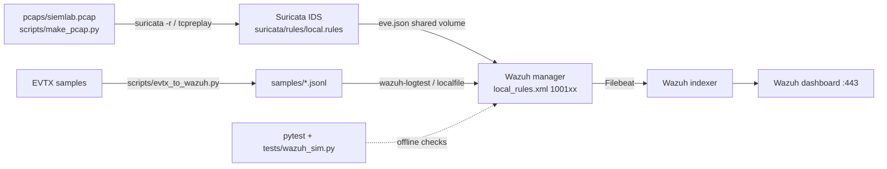

# siem-lab — Wazuh SIEM + Suricata IDS detection lab

**What it does:** runs Wazuh (manager + indexer + dashboard) and Suricata in Docker, feeds Suricata `eve.json` and converted Windows Security/Sysmon/PowerShell EVTX into Wazuh, and raises custom alerts mapped to MITRE ATT&CK.
Detections cover password spray, logon after repeated failures, special-privilege logons, log clearing, malicious PowerShell, LSASS access, WMI-spawned shells, and nmap-style scans.
Rule logic is unit-tested offline (pytest) against public EVTX attack samples and synthetic events. Live results below come from a run on 2026-10-12 with wazuh/wazuh-manager 4.9.2 (`wazuh-logtest`) and Suricata 7.0.7 (jasonish/suricata:7.0.7, offline `-r` on `pcaps/siemlab.pcap`). Raw output is in [`results/`](results/): [logtest](results/wazuh_logtest.txt), [per-file summary](results/wazuh_logtest_summary.txt), [eve.json alerts](results/suricata_alerts.jsonl).

> **No dashboard screenshot is included.** The rules were checked with `wazuh-logtest` on a real 4.9.2 manager, and Suricata was run on the pcap. The indexer and dashboard were not deployed for this run.

## Architecture


## Run it
```bash
# 0. offline checks (no Docker needed)
python3 -m venv .venv && .venv/bin/pip install -r requirements-dev.txt
.venv/bin/python -m pytest -v tests            # -> results/pytest.txt
.venv/bin/python scripts/sim_report.py         # -> results/sim_report.txt
# 1. Wazuh certs + indexer/dashboard configs: copy config/ from the official
#    wazuh-docker repo (single-node, same tag as the images, 4.9.2 here) then:
docker compose -f generate-indexer-certs.yml run --rm generator
sudo sysctl -w vm.max_map_count=262144
# 2. up
SURICATA_IFACE=eth0 docker compose up -d && ./scripts/setup_manager.sh
# 3. EVTX path: run every sample through the real rule engine
./scripts/logtest.sh                           # -> results/wazuh_logtest.txt
# 4. Network path: generate benign pcap, replay through Suricata
./scripts/replay.sh                            # -> results/suricata_alerts.jsonl
# 5. Dashboard https://localhost  -> Threat Hunting, filter rule.groups: siemlab -> screenshot to docs/alerts.png
```
Re-convert EVTX: `.venv/bin/python scripts/evtx_to_wazuh.py ../evtx-triage/samples samples/evtx`

## Alerts
| Rule | Fires on | ATT&CK | Offline sim | Live Wazuh |
|---|---|---|---|---|
| 100110 | 4625 from one IP, ≥5 distinct users / 120s | T1110.003 | synthetic ✔ | ✔ fired, level 12 (1× after 5 events; [log](results/wazuh_logtest.txt)) |
| 100111 | 4771 status 0x18, ≥5 users / 120s | T1110.003 | rule exists; real sample has only 2 events (correctly no alert) | no alert, as expected: real sample has 2 matching 4771 events (100101 L3 ×2), below the threshold of 5 |
| 100112 | 4768 status 0x6, ≥5 users / 120s | T1110.003, T1087.002 | real EVTX ✔ | ✔ fired, level 10 (1×, kerberos_pwd_spray_4771 sample, 6× 100102 building block) |
| 100114 | 4624 after ≥5 4625 for same user / 600s | T1110, T1078 | synthetic ✔ | ✔ fired, level 13 (1×, synthetic) |
| 100120/100121 | 4672 non-SYSTEM, non-machine ($) account (+SeDebugPrivilege) | T1078, T1134 | synthetic ✔ (SYSTEM and WS01$ skipped) | ✔ 100121 fired, level 8 (ansar.admin + SeDebugPrivilege); SYSTEM and WS01$ correctly skipped. No sample has a non-SeDebug 4672, so 100120 alone (L6) was never the final alert |
| 100130 | 1102 Security log cleared | T1070.001 | real EVTX ✔ | ✔ fired, level 12 (DE_1102 sample; also 1× in kerberos sample, which contains a 1102) |
| 100140 | 4104 scriptblock w/ Mimikatz/MiniDumpWriteDump/DownloadString… | T1059.001 | real EVTX ✔ | ✔ fired, level 12 (1×) |
| 100150 | Sysmon 10, target lsass.exe, credential-dump access masks | T1003.001 | real EVTX ✔ | ✔ fired, level 14 (1×) |
| 100160 | Sysmon 1, WmiPrvSE.exe → cmd/powershell | T1047 | synthetic ✔ (WerFault child ignored) | ✔ fired, level 12 (1×, synthetic) |
| Suricata 9000001-5 | SYN scan threshold, NULL, XMAS, test marker URI, Nmap NSE UA | T1046 / T1595 | pcap generated (37 packets) | ✔ all 5 fired once each in eve.json (Suricata 7.0.7, 37 packets; [alerts](results/suricata_alerts.jsonl)); fed back into Wazuh, eve alerts hit built-in rule 86601 ([log](results/wazuh_logtest_suricata_eve.txt)) |

Full per-file offline hits: `results/sim_report.txt`.

Wazuh live results are after the fix described below. Before it, **no custom rule fired** (0 hits on 220 events; [`results/wazuh_logtest_before_fix.txt`](results/wazuh_logtest_before_fix.txt)).

## Live run, 2026-10-12
- Tools: wazuh/wazuh-manager:4.9.2 (v4.9.2 rev 40921), Suricata 7.0.7 (jasonish/suricata:7.0.7), Docker 26.1.5 on Debian 13. The manager ran standalone with no indexer or dashboard.
- **Windows decoder / `if_group windows`: confirmed NOT matching** for replayed JSON. `wazuh-logtest` (also with `-l EventChannel`) decodes these events with the generic `json` decoder. The built-in `windows_eventchannel` decoder only handles events from a Windows agent's eventchannel queue, so base rule 60000 and the `windows` group never fire.
- Fix: bridge rule `100199` (level 0, `decoded_as json` plus a `win.system.eventID` field, group `windows`) in `local_rules.xml`. Agent events still go through 60000. JSON replayed through logtest or localfile now reaches the same rules.
- `scripts/logtest.sh` fixes: the glob `samples/*.jsonl` matched no files (samples are in subfolders). It also started a new logtest session per line, which prevented frequency rules from ever correlating. It now runs one session per file.
- `docker-compose.yml`: bind-mounting `local_rules.xml` directly into `/var/ossec/etc/rules` left the manager without `ossec.conf` (analysisd didn't start). It now mounts through `/wazuh-config-mount/etc/rules/`, which the image entrypoint copies.

## Bug found while testing
Real EVTX stores Kerberos status zero-padded (`0x00000006`), so a naive `^0x6$` never matches. Rules use `^0x0*6$`. The same bug turned up in the earlier evtx-triage project.

## Limits (honest)
- Wazuh was validated with `wazuh-logtest` only. No Windows agent was used, and the full indexer/dashboard stack was not deployed. `tests/wazuh_sim.py` remains an approximation: it has no timeframe enforcement, no `ignore`, and no decoder.
- The rules were not tested with events from a real Windows agent. That path should go through 60000/`windows_eventchannel`, but this is unverified here.
- The `win.system.eventID` field names and casing work with the JSON samples in logtest. They have not been compared with real agent output.
- The WMI real sample (LM_WMI_4624_4688) uses Security 4688, not Sysmon 1, so rule 100160 is only tested on synthetic data.
- Detections from evtx-triage that were not ported: PsExec pipes, COM hijack, LOLBins, schtasks, 4720.
- Compose passwords are lab defaults. Do not expose the lab to the internet.

## Interview Q&A
See [NOTES.md](NOTES.md).
